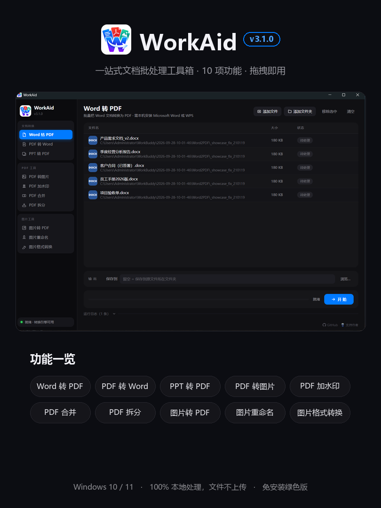

<div align="center">
  
</div>

# WorkAid

> 一站式文档批处理工具箱 —— 10 个常用文档处理功能，批量处理，拖拽即用。

一款 Windows 桌面端文档处理工具。v3 起采用 **Tauri 2 + WebView 前端 + Python 转换引擎** 的混合架构：界面现代化（浮岛式侧栏、深/浅双主题、可跟随系统），转换引擎沿用久经打磨的纯 Python 流水线，**文件全程本机处理、不联网**。

## 功能

| 功能 | 说明 |
| --- | --- |
| **Word 转 PDF** | 批量将 Word 文档转为 PDF |
| **PDF 转 Word** | 批量将 PDF 转为可编辑的 Word 文档（无需本机安装 Office） |
| **PPT 转 PDF** | 批量将 PPT 演示文稿转为 PDF |
| **PDF 转图片** | 将 PDF 每一页导出为图片 |
| **PDF 加水印** | 批量为 PDF 添加文字或图片水印，支持平铺/居中、浓度与角度调节 |
| **PDF 合并** | 将多个 PDF 合并为一个 |
| **PDF 拆分** | 按每页拆分或按页码范围拆分 |
| **图片转 PDF** | 将多张图片合并为一个 PDF |
| **图片重命名** | 批量重命名图片：模板编号 / 添加前后缀 / 查找替换，实时预览新文件名（无需 Office） |
| **图片格式转换** | PNG / JPG / WEBP / BMP / TIFF / ICO 批量互转，透明背景自动处理（转 JPG 铺白底、ICO 限 256px），JPG/WEBP 可调质量 |

所有批量功能均支持：**文件/文件夹拖拽添加**、**列表上移/下移排序**、**统一输出目录**、**实时进度**、**随时停止**。

## 下载使用

前往 [WorkAid-releases](https://github.com/gityongzhong/WorkAid-releases/releases/latest) 页面下载最新版 `WorkAid_vX.Y.Z_portable.zip`（v3.1.0 起）。下载仓库只放安装包，源码不公开。

- **免安装**：解压到任意位置，双击 `WorkAid.exe` 即可运行（`WorkAid.exe` 与 `workaid-cli` 文件夹需放在同一层）
- **无需配置**：所有依赖已打包，目标电脑无需安装 Python 或任何运行库
- **首次启动**：Windows 可能提示"未知发布者"（点"更多信息 → 仍要运行"）；首次启动因杀毒扫描可能稍慢，之后秒开

### 提示"没有找到转换引擎"怎么办

多半是文件没带全。正确的解压结构是：

```
WorkAid_v3.3.0_portable\
├── WorkAid.exe          ← 双击这个
├── 使用说明.txt
└── workaid-cli\         ← 必须与 exe 同一层
    ├── workaid-cli.exe
    └── _internal\
```

按出现频率排查：

1. **只拷了 `WorkAid.exe`**（拖到桌面、发快捷方式）→ 把整个文件夹一起拷贝，快捷方式请右键 exe「发送到 → 桌面快捷方式」
2. **在压缩包里直接双击**（路径栏是 `Temp\Rar$...`）→ 先完整解压再运行
3. **杀毒软件把 `workaid-cli.exe` 隔离了** → 从隔离区恢复，并把整个软件目录加进白名单（PyInstaller 打包的程序误报率较高）
4. **层级被改动**（文件夹被改名、内容被摊平）→ 按上面的结构还原

### 主题

侧栏品牌行右侧的图标可切换 **深色 / 浅色 / 跟随系统** 三种模式，点一次切一档，选择会被记住。选「跟随系统」时，Windows 切换深浅色会实时跟着变（Win11 的标题栏也会同步；Win10 标题栏不支持深色，会保持系统色）。

v3.2.0 起，引擎缺失时软件会自动弹窗，直接列出**实际查找过的路径**，并带「打开程序文件夹」按钮，对照一下即可定位。高级用法：设置环境变量 `WORKAID_CLI` 指向任意位置的 `workaid-cli.exe`。

## 支持作者

WorkAid 永久免费、无广告、无捆绑。如果它帮到了你，欢迎请作者喝杯咖啡 ☕

- **微信打赏**：打开软件 → 页脚右下角「支持作者」→ 微信扫码
- 源码托管在 GitHub：页脚「GitHub」可直达仓库，也欢迎点个 [Star](../../stargazers) 或推荐给朋友

## 环境要求

- Windows 10 / 11（64 位）
- 支持高 DPI 屏幕（100% / 125% / 150% 缩放均清晰渲染）
- 若需使用 Word / PPT 转 PDF，目标电脑需安装 Microsoft Office 或 WPS

> 注：PDF 转 Word、PDF 加水印、PDF 合并、PDF 拆分、PDF 转图片、图片转 PDF、图片重命名均为纯 Python 实现，**不依赖任何办公软件**。

## 从源码运行

### v3（Tauri 版，当前主版本）

```bash
# 前置：Node.js 18+、Rust (MSVC)、Python 3.12（转换引擎）
cd tauri-app
npm install

# 引擎：先用 PyInstaller 打包 workaid-cli（仓库根目录）
cd ..
.venv312\Scripts\python.exe -m PyInstaller --noconfirm WorkAidCLI.spec

# 开发 / 构建
cd tauri-app
npx tauri dev          # 开发调试
npx tauri build        # 产出安装包 + release exe
```

### 经典版（Python + Tkinter，v1.x，已冻结维护）

```bash
python -m venv .venv312
.venv312\Scripts\activate
pip install pymupdf pdf2docx python-docx pillow tkinterdnd2 pywin32 pyinstaller
python word2pdf.py
```

## 打包

```bash
# v3 引擎（若改过 cli.py / converters.py）
.venv312\Scripts\python.exe -m PyInstaller --noconfirm WorkAidCLI.spec

# v3 桌面程序（release）
cd tauri-app && npx tauri build
```

## 项目结构

```
WorkAid/
├── tauri-app/               # v3 桌面程序（当前主版本）
│   ├── ui/                  #   前端（原生 HTML/CSS/JS：主题、10 页配置、主逻辑）
│   └── src-tauri/           #   Rust 壳（窗口、进程调度、文件系统）
├── cli.py                   # 转换引擎 CLI 入口（batch 元动作，供 Rust 调用）
├── converters.py            # 全部转换与处理函数（无 GUI 依赖，v1/v3 共用）
├── WorkAidCLI.spec          # 引擎 PyInstaller 打包配置（onedir）
├── word2pdf.py              # 经典版主入口（v1.x，已冻结）
├── pages.py / widgets.py / theme.py   # 经典版界面模块
├── WorkAid.spec             # 经典版打包配置
├── app.ico                  # 应用图标
└── donate_qr.png            # 微信赞赏码
```

## 版本历史

| 版本 | 变更 |
| --- | --- |
| 3.3.0 | 主题切换：深色 / 浅色 / 跟随系统，品牌行一键循环，偏好持久化 |
| 3.2.0 | 引擎缺失引导：自动弹窗列出实际查找路径 + 打开程序文件夹 + 重新检测；执行前拦截 |
| 3.1.0 | 侧栏「浮岛式」改版：每个分组一块独立深色面板，三层视觉纵深 |
| 3.0.9 | 移除页脚左侧版本提示文案 |
| 3.0.8 | 「支持作者」弹窗文案精简 |
| 3.0.7 | 页脚新增 GitHub 仓库入口（系统浏览器打开） |
| 3.0.6 | 拖入文件区空状态图标更换并修复居中 |
| 3.0.5 | 页脚「支持作者」换咖啡杯图标 |
| 3.0.4 | 全新软件 LOGO（exe 图标 + 界面品牌位） |
| 3.0.3 | 修复转换成功误报失败、中文乱码、PPT 转 PDF 崩溃、A4 横版失效；全功能矩阵 23/23 通过 |
| 3.0.2 | 消除转换时弹出的黑色控制台窗口 |
| 3.0.1 | 性能优化：启动就绪 17.2s → 0.8s，批量转换提速 2.5 倍 |
| 3.0.0 | 架构重写：Tauri 2 + WebView 前端 + Python 引擎子进程，免安装绿色版 104MB，启动 < 1s |
| 1.13.1 | 经典版最终版：修复图片水印入口等（其后进入 v3 重写） |
| 1.13.0 | 新增「图片格式转换」：PNG / JPG / WEBP / BMP / TIFF / ICO 批量互转 |
| 1.12.8 | "支持作者"弹窗标题文字居中显示 |
| 1.12.7 | "支持作者"弹窗标题栏不再显示图标，更清爽 |
| 1.12.6 | 更换微信赞赏码（新图案） |
| 1.12.5 | 拖拽区提示箭头改为圆底白箭头图标（原字符缺字形显示为问号），全功能自检通过 |
| 1.12.4 | "支持作者"弹窗"关闭"按钮与背景同色，观感更统一 |
| 1.12.3 | "支持作者"弹窗与二维码图缩小一半，更轻量 |
| 1.12.2 | "支持作者"改为弹窗显示微信赞赏码（纯本地、无外网依赖） |
| 1.12.1 | 页脚新增"支持作者"入口（打赏页链接），README 增加赞助章节 |
| 1.12.0 | 新增「图片重命名」：批量重命名图片，支持模板编号 / 前缀 / 后缀 / 查找替换，实时预览与冲突检测 |
| 1.11.7 | 页脚上侧新增分隔线（#3a3a3a），与内容区分界更清晰 |
| 1.11.6 | 侧边栏底色 #1d1d1d → #111111，与窗口背景统一（右侧分隔线保留） |
| 1.11.5 | 全部功能页移除"完成后打开输出文件夹"选项及自动打开行为 |
| 1.11.4 | 标题栏/边框色值微调 #111111 → #1d1d1d（与卡片同色） |
| 1.11.3 | Windows 11 标题栏染色：标题栏/边框与界面同为深色（Win10 及以下自动保持系统默认） |
| 1.11.1 | 主色更换为 iOS 蓝 #007AFF |
| 1.11.0 | 高分屏适配：开启 DPI 感知，界面按系统缩放（125%/150%）等比渲染，彻底解决文字与圆角发虚 |
| 1.10.3 | 全局去描边，控件改为纯色块风格 |
| 1.10.2 | 圆角改用真圆弧采样绘制，轮廓更平滑 |
| 1.10.1 | 全部控件圆角统一为 12px |
| 1.10.0 | 新增「PDF 转 Word」批量功能 |
| 1.9.0 | 所有批量页新增上移/下移排序 |
| 1.8.6 | 默认窗口高度调整为 720 |
| 1.8.5 | 修复按钮图标与文字未居中 |
| 1.8.0 | 新增「PDF 加水印」 |
| 1.7.0 | 新增「PDF 拆分」 |
| 1.6.0 | 界面改版为左侧边栏布局 |
| 1.5.0 | 支持 Office / WPS 双引擎 |
| 1.4.0 | 新增「PPT 转 PDF」 |
| 1.3.0 | 新增「PDF 合并」 |
| 1.2.0 | 新增「图片转 PDF」 |
| 1.1.0 | 新增「PDF 转图片」 |
| 1.0.0 | 首个版本：Word 转 PDF |

## 许可

**个人非商业用途免费** —— 可免费安装使用，可在个人之间转发原始安装包。

**商业用途需授权** —— 含企业内部办公、嵌入商业产品、对外提供服务，请联系 hongyongzhong2020@126.com。

**不提供源代码** —— 本软件为专有软件，仓库不对外公开；禁止反编译、逆向工程或分发修改版。

详细条款见 [LICENSE](LICENSE)。

> 说明：v3.3.0 及更早的版本曾以 MIT 许可公开发布，其授权不因本次变更而改变。
